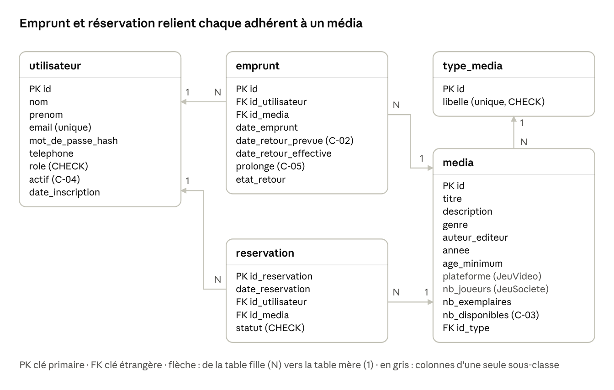

# Modèle logique de données (MLD)

Groupe 3 — Ludothèque : Celisse Kyllian, Diarrassouba Noah, Gamon Thomas, Hego Maxence.

Notation : **clé primaire** en gras, # = clé étrangère.

- **utilisateur** (**id**, nom, prenom, email UNIQUE, mot_de_passe_hash, telephone, role, actif, date_inscription)
- **type_media** (**id**, libelle UNIQUE)
- **media** (**id**, titre, description, genre, auteur_editeur, annee, age_minimum, plateforme, nb_joueurs,
  nb_exemplaires, nb_disponibles, #id_type → type_media.id)
- **emprunt** (**id**, #id_utilisateur → utilisateur.id, #id_media → media.id, date_emprunt,
  date_retour_prevue, date_retour_effective, prolonge, etat_retour)
- **reservation** (**id_reservation**, date_reservation, #id_utilisateur → utilisateur.id,
  #id_media → media.id, statut)

Toutes les associations sont de type 1–N : la clé étrangère est toujours portée par la table côté N.

| Association | Tables | Cardinalités |
| --- | --- | --- |
| effectue (emprunt) | utilisateur → emprunt | un utilisateur effectue 0..N emprunts, un emprunt est effectué par 1 utilisateur |
| concerne | emprunt → media | un emprunt concerne 1 média, un média est concerné par 0..N emprunts |
| effectue (réservation) | utilisateur → reservation | un utilisateur effectue 0..N réservations, une réservation est faite par 1 utilisateur |
| porte sur | reservation → media | une réservation porte sur 1 média, un média fait l'objet de 0..N réservations |
| est de type | media → type_media | un média est d'1 type, un type regroupe 0..N médias |

## Décisions de conception

| Choix | Justification |
| --- | --- |
| Héritage de `Media` en **table unique** | 4 sous-classes mais seulement 2 colonnes spécifiques (`plateforme`, `nb_joueurs`) : peu de NULL, aucune jointure à la lecture. Le DAO lit `type_media.libelle` et instancie la bonne sous-classe (Factory, diapo 7) |
| Libellés de `type_media` = noms de l'enum Java | Le CDC impose `JEU_VIDEO`, `JEU_SOCIETE`, `BANDE_DESSINEE`, `MANGA` : `TypeMedia.valueOf(libelle)` suffit, et un `CHECK` refuse tout autre libellé |
| Pas de colonne `statut` dans `emprunt` | Donnée dérivée : se déduit des dates (RENDU si `date_retour_effective` est remplie, EN_RETARD si la date prévue est dépassée), calculée par `Emprunt.getStatut()` |
| `nb_disponibles` conservé | Dérivée **assumée** : protégée par un `CHECK` (0 ≤ `nb_disponibles` ≤ `nb_exemplaires`) et modifiée seulement dans une transaction, par un UPDATE conditionnel (exception autorisée par le diapo 8) |
| `statut` stocké dans `reservation` | Non calculable : une annulation est une décision |
| C-02 et C-03 en `CHECK` | Une règle sur une seule ligne s'écrit en contrainte : la base la garantit même si le Java a un bug (`chk_emprunt_duree`, `chk_media_disponibles`) |
| Rôle porté par le compte | Le CDC (section 2) donne un rôle global par utilisateur (`ADHERENT` ou `ADMIN`, contrainte `CHECK`) |
| `mot_de_passe_hash` au format `sel:hash` | Mot de passe jamais stocké en clair : hachage PBKDF2 salé, sel et hash dans la seule colonne prévue par le CDC |
